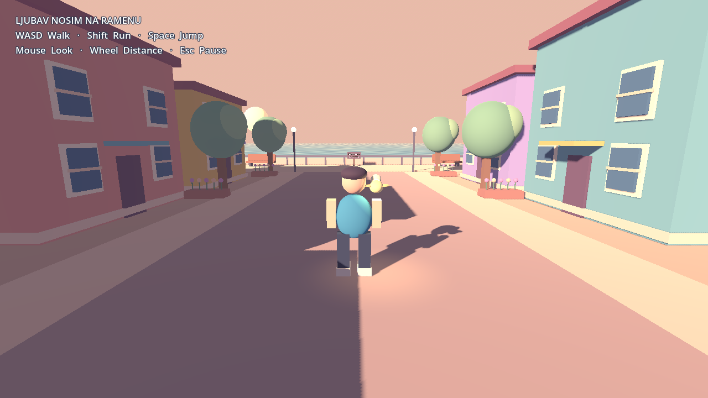

# Ljubav nosim na ramenu

A first playable, peaceful third-person coastal exploration prototype for **Godot 4**. A small golden bird rides on a traveler's shoulder as they explore a pastel neighborhood and sunset promenade. All geometry, materials, animation, and water are generated locally; no paid assets, external APIs, or third-party music are used.



## Open and play

1. Install **Godot 4.6.3** (the tested version; use this version for reproducible results).
2. Clone this repository and import `project.godot` in Godot's project manager.
3. Open the project, press **F6** on `scenes/main.tscn` or **F5**, then choose **Start Game**.
4. Walk down the street toward the ocean. Approach the small seaside plaque and press **E** to read the note.

Or run `godot --path .` from the repository directory. The Compatibility renderer supports ordinary desktop OpenGL hardware. The main menu intentionally pauses simulation until Start Game.

| Control | Action |
| --- | --- |
| W / A / S / D | Camera-relative movement |
| Mouse | Orbit camera |
| Mouse wheel | Adjust camera distance (2.5–9 meters) |
| Shift | Sprint |
| Space | Jump |
| E | Interact with the nearby seaside plaque |
| Escape | Pause / resume and release / capture mouse |

Settings provide session-local mouse sensitivity and soundtrack volume. Exit Game closes the application.

## Structure

- `scenes/main.tscn`: playable scene, built by `scripts/game.gd`; menu, pause, input mapping, interaction UI.
- `scenes/player.tscn`, `scripts/player.gd`: CharacterBody3D controller, acceleration, gravity, procedural humanoid, walking animation, orbit camera and collision spring arm.
- `scenes/bird.tscn`, `scripts/bird.gd`: reusable shoulder companion with emissive materials, local light, idle bob and wing motion.
- `scripts/neighborhood.gd`: bounded coastal street, eight buildings, trees, flowers, benches, warm sun, sky, fog and animated ocean.
- `scripts/geometry.gd`: shared procedural mesh/material/collision helpers.
- `scripts/interactable.gd`: example interaction object and signal; future dialogue or mission listeners can subscribe without coupling them to the controller.
- `scripts/music.gd`: silent-by-default soundtrack player. Supply an original Indig0kid `AudioStream` to `play_track()`; no recordings are bundled.
- `tests/smoke.gd`: executable functional checks using real physics and scene instances.

## Validation

From the project directory:

```sh
godot --headless --path . --editor --import --quit
godot --headless --path . --script res://tests/smoke.gd
```

The smoke runner checks startup, floor collision, walking, sprinting, jumping/landing, building collision, camera collision/zoom, the bird instance, interaction and pause/resume. Captured mouse motion is additionally checked with a graphical display; it is explicitly skipped headlessly. To render and save a screenshot to `/tmp/ljubav-prototype.png`, run with a display:

```sh
godot --path . --script res://tests/smoke.gd -- --capture
```

In restricted Linux cloud environments, point `XDG_DATA_HOME`, `XDG_CONFIG_HOME` and `XDG_CACHE_HOME` to writable directories before launching Godot. This is unnecessary on a normal Windows installation.

## Windows PC export

A Windows Desktop x86_64 preset is included. In Godot, install the **matching 4.6.3 export templates** using **Editor → Manage Export Templates**, create a `build` directory, then choose **Project → Export → Windows Desktop → Export Project**. Or run:

```sh
mkdir -p build
godot --headless --path . --export-release "Windows Desktop" build/Ljubav-nosim-na-ramenu.exe
```

Distribute both the exported `.exe` and its companion `.pck` file.

The prototype uses portable GDScript and Compatibility rendering. A Windows executable and native Windows playtest are not included in this initial source prototype; exporting requires the matching templates.

## Prototype boundaries

Art and animation are procedural placeholders with a warm pastel direction, not final anime production assets. Compatibility rendering uses emission and a local light for the bird; bloom is not required. The soundtrack is intentionally silent pending original music. Settings are session-local. NPCs, conversations, quests, larger neighborhoods, customization and narrative events are deferred.
